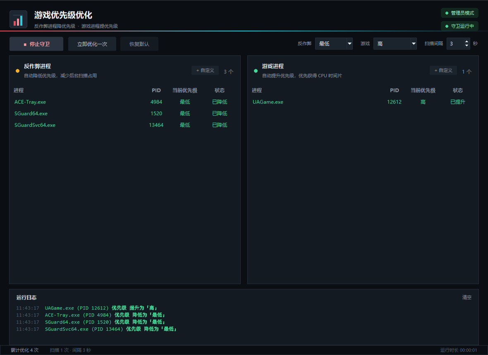

# 游戏优先级优化工具 Pro（Game Priority Booster）

一个 Windows 桌面小工具：把**反作弊进程**的 CPU 优先级压到最低、把**游戏主进程**的优先级提上去，让游戏多拿一点 CPU 时间片。只调用 Windows 自带的进程优先级 API，不读写游戏内存、不注入、不挂钩子。

> 支持游戏：穿越火线 / 无畏契约 / 三角洲行动 / 暗区突围：无限 / PUBG·和平精英（也可自定义进程）



---

## 特性

- **深色 GUI 常驻面板**，双栏实时列表（反作弊 / 游戏），状态按颜色分级
- **四重进程识别**：进程名完全匹配 / 关键字包含 / 安装路径关键字 / **游戏窗口标题反查 PID**
- 自动启用 `SeDebugPrivilege`，并用 `OpenProcess(PROCESS_SET_INFORMATION)` 直接调用 `SetPriorityClass`
- **写入后回读校验**：被反作弊重置会显示「被重置」并在下一轮自动重设
- 失败原因可视化：权限不足 / 状态受限 / 被重置，全部写入运行日志，不再静默失败
- 支持「+ 自定义」追加进程名（游戏改 exe 名时无需改代码）
- 参数可调：反作弊等级、游戏等级、扫描间隔（1–60 秒），改动自动落盘
- 启动自动申请管理员权限（UAC 取消则降级为普通权限并提示）
- 单文件 exe 打包，无第三方运行时依赖（除 `psutil`）

---

## 工作原理

```
┌──────────────┐   psutil.process_iter    ┌──────────────────┐
│ 进程快照      │ ───────────────────────► │ 规则匹配          │
│ (pid,name)   │                          │ name → kw → path │
└──────────────┘                          └────────┬─────────┘
                                                   │ 未命中
┌──────────────┐   EnumWindows + 标题关键字        ▼
│ 可见窗口标题  │ ───────────────────────► 兜底识别游戏 PID
└──────────────┘
                          │
                          ▼
        ┌─────────────────────────────────────┐
        │ GetPriorityClass 读取当前优先级       │
        │ SetPriorityClass 写入目标优先级       │
        │ 回读比对 → 成功 / 权限不足 / 被重置    │
        └─────────────────────────────────────┘
```

优先级常量沿用 Win32 语义：

| 常量 | 值 | 说明 |
|---|---|---|
| `IDLE_PRIORITY_CLASS` | 0x40 | 最低（反作弊默认） |
| `BELOW_NORMAL_PRIORITY_CLASS` | 0x4000 | 低于正常 |
| `NORMAL_PRIORITY_CLASS` | 0x20 | 正常（「恢复默认」用这个） |
| `ABOVE_NORMAL_PRIORITY_CLASS` | 0x8000 | 高于正常 |
| `HIGH_PRIORITY_CLASS` | 0x80 | 高（游戏默认） |
| `REALTIME_PRIORITY_CLASS` | 0x100 | 实时（慎用） |

---

## 识别规则（可在 `GAME_RULES` / `ACE_RULES` 里直接改）

| 类型 | 分组 | 名称 / 关键字 |
|---|---|---|
| 游戏 | 穿越火线 | `crossfire.exe` `cfhd.exe` … / 关键字 `crossfire` |
| 游戏 | 无畏契约 | `valorant.exe` `VALORANT-Win64-Shipping.exe` / 关键字 `valorant` |
| 游戏 | 三角洲行动 | `DeltaForceClient-Win64-Shipping.exe` `DeltaGame.exe` / 关键字 `deltaforce` |
| 游戏 | 暗区突围 | `ArenaBreakoutInfinite.exe` `ABInfinite-Win64-Shipping.exe` / 关键字 `arenabreakout` `abinfinite` |
| 游戏 | PUBG / 和平精英 | `TslGame.exe` / 关键字 `tslgame` |
| 反作弊 | ACE | `ACE-Tray.exe` `ACE-Guard Client.exe` `SGuard64.exe` `SGuardSvc64.exe` / 关键字 `sguard` `ace-guard` `ace-tray` |
| 反作弊 | Vanguard | `vgc.exe` `vgk.exe` / 关键字 `vgc.exe` `vanguard` |
| 反作弊 | TenProtect | `TmMon.exe` `TPHelper.exe` / 关键字 `tmmon` `tphelper` |

> 实测：`UAGame.exe`（暗区突围真实进程名）靠**窗口标题**才认得出，这是纯名称匹配必然漏掉的场景。

---

## 快速开始

### 直接用 exe

1. 双击 `游戏优先级优化工具Pro.exe`，UAC 弹窗点「是」
2. 启动后自动开始守卫（默认 3 秒一轮），打开游戏后自动识别
3. 想还原：点「恢复默认」

### 从源码运行

```bash
pip install -r requirements.txt
python game_priority_pro.py
```

> 建议以管理员身份运行（或在程序里点右上角「以管理员重启」），否则受保护进程会提示「权限不足」。

### 自行打包

```bash
pip install pyinstaller
pyinstaller --noconfirm --onefile --windowed ^
  --icon icon_pro.ico ^
  --name "游戏优先级优化工具Pro" ^
  game_priority_pro.py
```

---

## 配置

首次运行会在 exe 同目录生成 `config_pro.json`：

```json
{
  "game_target": 128,
  "ace_target": 64,
  "interval": 3,
  "auto_start": true,
  "auto_elevate": true,
  "custom_games": [],
  "custom_ace": []
}
```

| 字段 | 说明 |
|---|---|
| `game_target` | 游戏目标优先级（128=高，32768=高于正常，256=实时） |
| `ace_target` | 反作弊目标优先级（64=最低，16384=低于正常） |
| `interval` | 扫描间隔秒数 |
| `auto_start` | 启动后是否自动开始守卫 |
| `auto_elevate` | 启动时是否自动请求管理员权限 |
| `custom_games` / `custom_ace` | 自定义进程名列表（也可在界面上点「+ 自定义」添加） |

---

## FAQ

**会不会封号？**
它只调用 Windows 的 `SetPriorityClass`，不读写游戏内存、不修改游戏文件、不注入 DLL。但从反作弊厂商的角度看，降低其进程优先级可能触及其保护策略，部分游戏的服务条款也未明确允许此类系统调优。**使用前请自行评估风险，建议先在非排位对局试。** 仓库作者不对账号状态作任何承诺。

**为什么有的进程显示「权限不足」？**
① 确认右上角是绿色的「管理员模式」；② ACE / Vanguard 有内核级自保护，即使管理员也可能拿不到句柄，这是正常现象，不影响游戏运行。

**改完没感觉到提升？**
优先级只在 CPU 接近满载时才有明显差别。8 核以上、占用不到 60% 的机器本来就不缺 CPU 时间片，提升幅度会很有限——这不是没生效。

**要一直开着吗？**
是。优先级是一次性设置，游戏或反作弊重启后会恢复默认，守卫需要常驻才能持续生效。

---

## 目录结构

```
.
├── game_priority_pro.py     # 主程序（单文件，无外部资源依赖）
├── icon_pro.ico             # 程序图标
├── screenshot.png           # 界面截图
├── requirements.txt
├── .gitignore
└── 使用说明.txt              # 面向普通用户的中文说明
```

---

## 免责声明

本项目仅供**个人学习 Windows 进程调度与系统 API** 使用。所有优先级修改都作用于进程级调度参数，不涉及游戏内存、外挂、自动化操作。使用本工具产生的一切后果（包括但不限于账号处罚、游戏异常、系统不稳定）由使用者自行承担。

如果你所在游戏的用户协议明确禁止修改其进程状态，请不要使用。
